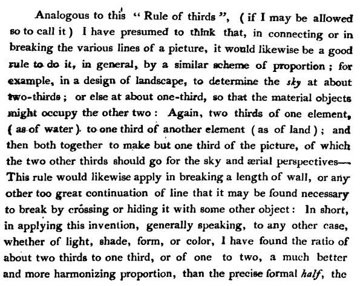

<figure>

<figcaption>

Original "rule of thirds" as first written by John Thomas Smith in his 1797 book _Remarks on Rural Scenery_ [^thomas-thirds-wiki]

</figcaption>
</figure>

### [Drive: The Quadrant System](https://youtu.be/wsI8UES59TM) — Tony Zhou (Every Frame a Painting)

<iframe class="youTubeIframe" width="560" height="315" src="https://www.youtube.com/embed/wsI8UES59TM" title="YouTube video player" frameborder="0" allow="accelerometer; autoplay; clipboard-write; encrypted-media; gyroscope; picture-in-picture; web-share" referrerpolicy="strict-origin-when-cross-origin" allowfullscreen></iframe>

### [Rule of Thirds- The #1 Reason NOT to Use It! (2021)](https://youtu.be/uTqUqD_TJAw) - Tavis Leaf Glover - IPOX studios

<iframe class="youTubeIframe" width="560" height="315" src="https://www.youtube.com/embed/uTqUqD_TJAw" title="YouTube video player" frameborder="0" allow="accelerometer; autoplay; clipboard-write; encrypted-media; gyroscope; picture-in-picture; web-share" referrerpolicy="strict-origin-when-cross-origin" allowfullscreen></iframe>

### [Center Framing: Mad Max, Wes Anderson & Kubrick](https://youtu.be/lD-g2feq_KM) - The Take

<iframe class="youTubeIframe" width="560" height="315" src="https://www.youtube.com/embed/lD-g2feq_KM" title="YouTube video player" frameborder="0" allow="accelerometer; autoplay; clipboard-write; encrypted-media; gyroscope; picture-in-picture; web-share" referrerpolicy="strict-origin-when-cross-origin" allowfullscreen></iframe>

In an interview with Roger Deakins by Phil Mistry for PetaPixel, Deakins is documented as saying “I am familiar with the ‘rule of thirds‘, but I have not considered it a conscious part of my approach since I attended art college in the 1960s,” [^deakins-petapixel]

In an interview by John Witmer for _American Cinemetographer_, David Lowery talks about needing to throw out the rule of thirds when shooting _A Ghost Story_ because the "sheet ghost" character would dominate the visual frame and required innovative compositional thinking beyond the rule of thirds. [^lowery-asc]

In a _British Cinemetographer_ article, writer

## References

[^thomas-thirds-wiki]: [Excerpt from John Thomas Smith's illustrated book, published in 1797, defining a compositional "rule of thirds"](https://en.wikipedia.org/wiki/Rule_of_thirds#/media/File:Rule_of_thirds_1797_John_Thomas_Smith_rule_of_thirds.png)
[^deakins-petapixel]: Roger Deakins: Legendary Cinematographer with a Photographer’s Eye [https://petapixel.com/roger-deakins-photography-interview/](https://petapixel.com/roger-deakins-photography-interview/)
[^lowery-asc]: A Ghost Story: Shared Spaces [https://theasc.com/article/david-lowery-directs-a-ghost-story/](https://theasc.com/article/david-lowery-directs-a-ghost-story/)
[^fremes]: [A new/old way to uplift cinematography](https://britishcinematographer.co.uk/a-new-old-way-to-uplift-cinematography/)
